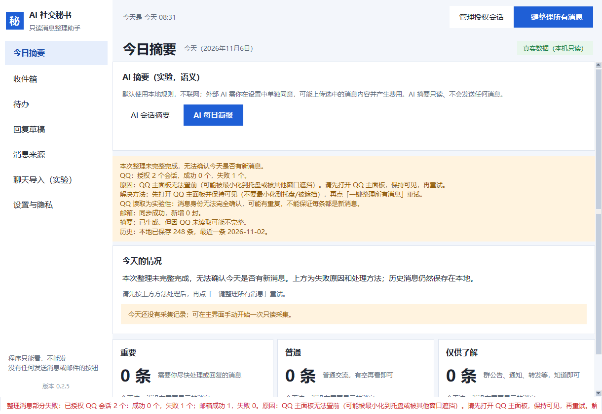

# AI 社交秘书（Social Secretary）

> **Windows 11 本地运行、隐私优先的 QQ 与 QQ 邮箱消息整理助手。**
>
> A privacy-first Windows 11 desktop assistant for organizing QQ chats and QQ Mail.

> **只读，不发送。** 本程序没有发送 QQ 消息、发送邮件、撤回或删除远端消息的能力。
>
> **QQ 聊天读取仍为实验性功能。** 消息可能漏读、重复保存，重要信息请以原始 QQ 客户端为准。



## 简体中文介绍

AI 社交秘书把 QQ 邮箱和（实验性的）QQ 聊天整理到本机，帮助你看清哪些消息需要处理：

- QQ 邮箱只读同步（IMAP）；
- 用户明确授权的 QQ 会话只读读取；
- 一键整理消息；
- 本地规则生成的摘要、分类和待办；
- 可编辑、可复制的回复草稿；
- 可选 DeepSeek 语义分析（默认关闭，需用户自备 Key 并同意）；
- 数据保存在本机 SQLite；邮箱授权码/API Key 只保存在 Windows 凭据管理器；
- 用户可暂停采集、撤销授权、删除本地数据；
- 不需要管理员权限常驻，不需要安装 Python（使用 Release 包时）。

## English

Social Secretary is a local-first Windows 11 desktop assistant. It reads only the QQ Mail inbox (IMAP) and explicitly authorized QQ chats, then produces local summaries, todos and editable reply drafts. It never sends QQ messages or email, never deletes remote messages, and never uploads content unless the user explicitly enables the optional external-AI feature.

QQ chat reading is experimental: messages may be missed or duplicated, and there is no verified permanent message ID from Windows UI Automation. Always verify important information in the original QQ client.

## 能力状态（如实区分）

| 能力 | 状态 |
|---|---|
| QQ 邮箱只读同步/正文/附件文件名/重启持久化 | 已有真实邮箱环境验证 |
| 消息中心/处理状态/待办/本地规则摘要/草稿 | 已实现，含离线测试 |
| QQ 单会话/多会话读取 | **实验性**；有限真实环境测试，A1 完整性预检存在 FAIL |
| QQ 消息精确身份/去重 | **未解决**；公开为已知限制 |
| 外部 DeepSeek 语义 | 默认关闭，需自备 Key；不保证真实模型质量 |
| 自动发送 QQ/邮件 | **不存在** |

## 下载与安装

1. 打开 [Releases](https://github.com/stellaris580/social-secretary/releases) 页面，下载最新实验版本：
   - 安装版：[SocialSecretary-v0.2.5-beta-installer.zip](https://github.com/stellaris580/social-secretary/releases/download/v0.2.5-beta/SocialSecretary-v0.2.5-beta-installer.zip)
   - 免安装便携版：[SocialSecretary-v0.2.5-beta-portable.zip](https://github.com/stellaris580/social-secretary/releases/download/v0.2.5-beta/SocialSecretary-v0.2.5-beta-portable.zip)
   - 校验：[SHA256SUMS-v0.2.5-beta.txt](https://github.com/stellaris580/social-secretary/releases/download/v0.2.5-beta/SHA256SUMS-v0.2.5-beta.txt)
2. 解压后双击 `安装.cmd`（安装版）或 `SocialSecretary.exe`（便携版）。
3. 不需要管理员权限，不需要单独安装 Python。
4. 首次使用请按应用内说明完成 QQ 邮箱授权和 QQ 会话选择；这些必须由你本人完成。

## 快速开始

1. 打开软件；
2. 点「一键整理所有消息」；
3. 查看今日摘要、待办、消息来源；
4. 需要回复时生成草稿，自己复制到 QQ/邮箱手动发送；
5. 在「设置与隐私」中可暂停采集、撤销授权、删除本地数据或卸载。

详细中文说明见 [新手指南](docs/USER_GUIDE.md)、[隐私及功能限制](docs/PRIVACY.md)。

## 隐私与安全

- 只读：不发送、不撤回、不删除、不修改 QQ/邮箱服务器数据；
- 不读 QQ 本地消息数据库，不抓取账号密码，不使用 QQ 非官方协议；
- 邮箱授权码和 API Key 只使用 Windows 凭据管理器；
- 外部 AI 默认关闭；启用前会明确提示上传范围和费用，只发送本次所需的少量内容；
- 本地数据可删除；卸载默认保留数据，用户明确选择时才删除；
- 首次账号授权必须由用户自己在软件中完成。

## QQ 实验性限制（请务必阅读）

**QQ 聊天读取仍处于实验阶段。**

- 不能保证完整读取全部历史消息；
- 部分消息可能遗漏；
- 同一条消息可能重复保存；
- Windows UIA 不提供已验证的永久消息 ID，无法可靠确认每条入库记录都是独立的新消息；
- 图片、文件、表情及部分群聊格式可能读取不完整；
- QQ 最小化、位于托盘或被遮挡时可能读取失败；
- 切换聊天可能改变 QQ 未读状态；
- 不能把一次扫描成功解释为 QQ 消息已完整同步；
- 重要信息请回原始 QQ 客户端核实。

**A1 消息完整性预检存在 FAIL；QQ 精确去重尚未解决。** 本版本不适合无人监管地处理重要 QQ 消息。

## 开发与测试

- Python 3.12；Windows 11；
- 运行时依赖见 `requirements.txt` / `pyproject.toml`；
- 测试不连接真实 QQ、邮箱或付费 AI，不需要管理员权限；
- Windows Tkinter GUI 测试需要桌面会话，CI 中会明确跳过而不是假装通过。

```powershell
python -m venv .venv
.\.venv\Scripts\python.exe -m pip install -e ".[dev]"
$env:QT_QPA_PLATFORM = "offscreen"
.\.venv\Scripts\python.exe -m pytest
```

构建 Windows 包需要 Windows + PyInstaller；入口见 `packaging/build.ps1`。公开构建说明见 [开发文档](docs/DEVELOPMENT.md)。

## 第三方与许可

- 本项目原创代码以 **MIT License** 发布（见 [LICENSE](LICENSE)）；
- 依赖组件及其许可证见 [THIRD_PARTY_NOTICES.md](THIRD_PARTY_NOTICES.md)；
- 本项目不包含腾讯/QQ 客户端代码，也不包含第三方 QQ 自动化参考仓库的源代码；
- UIA 选择器/方案设计参考了 `treers2/qq-operations` 等公开资料，仅作设计研究；如需复用其代码，必须遵守其 MIT 许可证并保留版权声明。

## 贡献与安全

- 贡献说明见 [CONTRIBUTING.md](CONTRIBUTING.md)；
- 安全漏洞请按 [SECURITY.md](SECURITY.md) 私下报告，不要在公开 Issue 中粘贴聊天记录、邮箱授权码、API Key 或私人截图。
